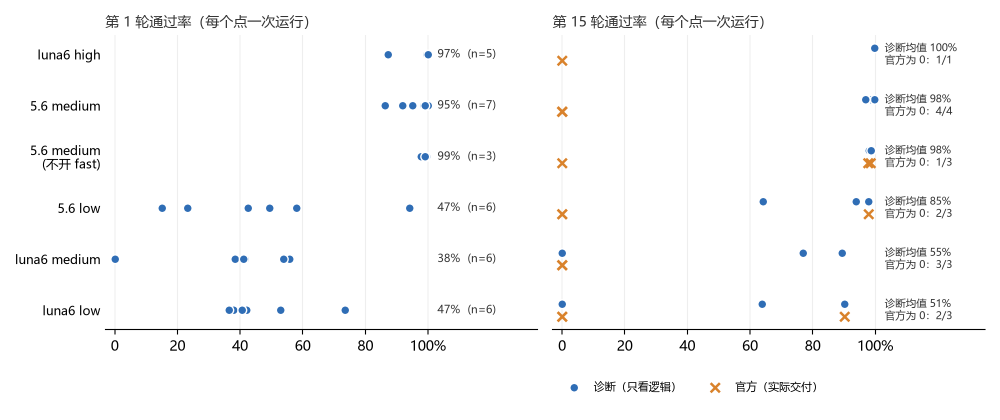

# 裸模型基线汇总（dpipe，2026-10-22）

本文汇总全部裸模型的真实运行：不加任何管理，OpenCode build agent 每轮开一个新会话，原样给本轮原文。它是后续对照组和 IC 的比较基准。逐次的细节见 OBSERVATIONS §2、§9、§11–§15；运行目录见 EXPERIMENT-MAP Q1。

**口径**
- **官方通过率**：官方测试在不联网的评分环境里跑出来的结果，也就是实际交付的结果。
- **诊断通过率**：同样的测试，只把主机的 Go 模块缓存只读挂进去，用来区分"环境装不起来"和"逻辑写错"。它不是正式成绩。
- **token**：每次运行 15 轮的合计，按会话的全部消息加总。
- 除了标注"不开 fast"的一组，都开着 fast。
- 第 1 轮的统计包括单独跑的第 1 轮，以及 15 轮运行的第 1 轮。

## 总表

| 模型（推理档） | 第 1 轮通过率：均值（最低–最高，次数） | 15 轮完整运行次数 | 第 15 轮诊断通过率：均值（最低–最高） | 第 15 轮官方通过率为 0 的次数 | 每次 15 轮 token：未缓存输入 / 缓存读 / 输出（均值） | 每次 15 轮编码用时（均值） |
|---|---|---|---|---|---|---|
| luna6 high | 97.2%（87.2–100.0%，5 次） | 1 | 99.8%（99.8–99.8%） | 1/1 | 0.54M / 7.20M / 0.08M | 24 分钟 |
| 5.6 medium | 94.7%（86.3–100.0%，7 次） | 4 | 98.1%（96.9–99.7%） | 4/4 | 0.63M / 10.27M / 0.09M | 32 分钟 |
| 5.6 medium（不开 fast） | 98.8%（97.7–99.5%，3 次） | 3 | 98.4%（97.9–98.8%） | 1/3 | 0.65M / 9.84M / 0.09M | 41 分钟 |
| 5.6 low | 47.0%（15.1–94.1%，6 次） | 3 | 85.2%（64.1–97.8%） | 2/3 | 0.43M / 4.86M / 0.06M | 19 分钟 |
| luna6 medium | 38.4%（0.0–55.7%，6 次） | 3 | 55.5%（0.0–89.4%） | 3/3 | 0.46M / 3.91M / 0.04M | 16 分钟 |
| luna6 low | 47.3%（36.5–73.5%，6 次） | 3 | 51.3%（0.0–90.1%） | 2/3 | 0.43M / 3.80M / 0.06M | 21 分钟 |

**每次运行的第 15 轮**（诊断 / 官方，满分 960）：

| 模型 | 各次 |
|---|---|
| luna6 high | 958 / 0 |
| 5.6 medium | 947 / 0；957 / 0；932 / 0；930 / 0 |
| 5.6 medium（不开 fast） | 940 / 938；948 / 0；947 / 945 |
| 5.6 low | 901 / 0；939 / 939；615 / 0 |
| luna6 medium | 0 / 0；858 / 0；739 / 0 |
| luna6 low | 612 / 0；0 / 0；865 / 865 |

**第 1 轮各次得分**（满分 219）：

| 模型 | 各次 |
|---|---|
| luna6 high | 218、218、218、191、219 |
| 5.6 medium | 201、208、219、216、217、201、189 |
| 5.6 medium（不开 fast） | 218、214、217 |
| 5.6 low | 93、33、51、206、127、108 |
| luna6 medium | 91、84、122、0、118、90 |
| luna6 low | 83、92、116、89、80、161 |

**逐轮诊断通过率均值**（15 轮完整运行，%）：

| 模型 | R1 | R2 | R3 | R4 | R5 | R6 | R7 | R8 | R9 | R10 | R11 | R12 | R13 | R14 | R15 |
|---|---|---|---|---|---|---|---|---|---|---|---|---|---|---|---|
| luna6 high | 100.0 | 99.6 | 99.6 | 99.7 | 99.0 | 99.0 | 99.1 | 99.1 | 99.1 | 99.8 | 99.8 | 99.8 | 99.8 | 99.8 | 99.8 |
| 5.6 medium | 93.9 | 96.9 | 97.2 | 97.4 | 96.8 | 97.0 | 97.1 | 97.2 | 97.3 | 98.0 | 97.9 | 97.9 | 98.0 | 98.0 | 98.1 |
| 5.6 medium（不开 fast） | 98.8 | 99.2 | 99.3 | 98.5 | 97.6 | 97.8 | 97.8 | 97.9 | 98.0 | 98.2 | 98.3 | 98.4 | 98.4 | 98.4 | 98.4 |
| 5.6 low | 67.1 | 76.8 | 79.6 | 81.5 | 80.6 | 81.6 | 82.0 | 82.4 | 83.2 | 84.0 | 84.4 | 84.7 | 84.9 | 85.2 | 85.2 |
| luna6 medium | 31.7 | 47.7 | 49.6 | 52.0 | 52.4 | 53.1 | 52.9 | 53.4 | 54.2 | 55.0 | 55.4 | 55.6 | 55.9 | 55.3 | 55.5 |
| luna6 low | 50.2 | 61.7 | 60.6 | 66.4 | 51.9 | 52.4 | 52.7 | 52.4 | 52.0 | 51.9 | 51.9 | 52.2 | 51.7 | 51.4 | 51.3 |

**其他任务**（5.6 medium，各 1 次；这两个任务的官方测试基本只测本轮内容）：

- secsentinel：15 轮，总通过率 99.8%（1131/1133），最低一轮 98.9%；token 0.69M / 10.43M / 0.10M；编码 33 分钟。
- eventq：13 轮，总通过率 90.2%（341/378），最低一轮 59.3%；token 0.60M / 11.51M / 0.10M；编码 33 分钟。

## 失败分类（第 15 轮）

失败分三类，分开统计：
- **逻辑错误**：诊断通过率没到 100% 的部分；
- **交付环境不符**：官方为 0 而诊断正常。原因是引入了需要联网下载的外部库，或者用了评分环境（Go 1.22.2）不支持的 Go 版本；
- **两者都有**：诊断也构建失败（工具链版本过高）的运行，逻辑失分无法度量。

**归因**：dpipe 的原文 15 轮里都没有写"离线""只用标准库"或 Go 版本，这些约束只存在于评分环境里。模型写代码的环境能联网，Go 是 1.27。所以这类失败归为"交付环境不符"：用户隐含的要求没有满足，原文没写，开发环境和交付环境也不一致。不归为"不遵守要求"或"理解偏差"。

对照：eventq 的原文写明了"必须离线构建"，模型照做，没有一轮因此归零。

| 模型 | 运行 | 第 15 轮官方 | 第 15 轮诊断 | 交付 | 逻辑失分（960 − 诊断） | 交付环境不符的原因 |
|---|---|---|---|---|---|---|
| luna6 high | 1 | 0 | 958 | **失败**：环境不符 | 2 | 外部库 |
| 5.6 medium | 1 | 0 | 947 | **失败**：环境不符 | 13 | 外部库 |
| 5.6 medium | 2 | 0 | 957 | **失败**：环境不符 | 3 | 外部库 |
| 5.6 medium | 3 | 0 | 932 | **失败**：环境不符 | 28 | 外部库 |
| 5.6 medium | 4 | 0 | 930 | **失败**：环境不符 | 30 | 外部库 |
| 5.6 medium（不开 fast） | 1 | 938 | 940 | 成功 | 20 | — |
| 5.6 medium（不开 fast） | 2 | 0 | 948 | **失败**：环境不符 | 12 | 外部库 |
| 5.6 medium（不开 fast） | 3 | 945 | 947 | 成功 | 13 | — |
| 5.6 low | 1 | 0 | 901 | **失败**：环境不符 | 59 | 外部库 |
| 5.6 low | 2 | 939 | 939 | 成功 | 21 | — |
| 5.6 low | 3 | 0 | 615 | **失败**：环境不符 | 345 | 外部库 |
| luna6 medium | 1 | 0 | 0 | **失败**：环境不符，诊断也构建不了 | 无法度量 | 外部库、go 1.23 |
| luna6 medium | 2 | 0 | 858 | **失败**：环境不符 | 102 | 外部库 |
| luna6 medium | 3 | 0 | 739 | **失败**：环境不符 | 221 | 外部库 |
| luna6 low | 1 | 0 | 612 | **失败**：环境不符 | 348 | 外部库 |
| luna6 low | 2 | 0 | 0 | **失败**：环境不符，诊断也构建不了 | 无法度量 | 外部库、go 1.26.0 |
| luna6 low | 3 | 865 | 865 | 成功 | 95 | — |

- **合计**：17 次运行中，13 次交付失败，其中 2 次连诊断也构建不了；4 次交付成功（5.6 medium 不开 fast ×2、5.6 low ×1、luna6 low ×1）。
- **交付成功的运行**：官方分和诊断分有 0–2 个用例的差别，来自个别用例不稳定，不算交付环境问题。
- **对照实验：写明目标环境**（见下节）。

## 对照：在原文里写明目标环境（5.6 medium fast，15 轮 ×3）

**做法**：每轮原文前加一句 "Delivery environment: the program is built and tested with Go 1.22.2 on a machine with no network access and no Go module cache."，其余与 5.6 medium（fast）基线完全相同。运行目录：`exp2-bare15-luna56-medium-envnote-rep{1,2,3}-dpipe-20261022`。

| 轮 | 用例数 | 官方通过率（第 1–3 次） | 诊断通过率（第 1–3 次） | 官方均值 |
|---|---|---|---|---|
| R1 | 219 | 98.6% / 69.4% / 98.6% | 98.6% / 69.4% / 98.6% | 88.9% |
| R2 | 481 | 98.1% / 97.1% / 99.4% | 98.1% / 97.1% / 99.4% | 98.2% |
| R3 | 535 | 98.3% / 97.4% / 99.4% | 98.3% / 97.4% / 99.4% | 98.4% |
| R4 | 639 | 97.3% / 96.6% / 94.8% | 97.3% / 96.6% / 94.8% | 96.2% |
| R5 | 680 | 96.8% / 95.9% / 93.4% | 96.8% / 95.9% / 93.4% | 95.3% |
| R6 | 716 | 96.9% / 96.1% / 93.7% | 96.9% / 96.1% / 93.7% | 95.6% |
| R7 | 739 | 96.9% / 96.2% / 93.6% | 96.9% / 96.2% / 93.6% | 95.6% |
| R8 | 769 | 97.0% / 96.4% / 93.9% | 97.0% / 96.4% / 93.9% | 95.8% |
| R9 | 816 | 97.2% / 96.6% / 94.2% | 97.2% / 96.6% / 94.2% | 96.0% |
| R10 | 851 | 97.4% / 97.2% / 94.9% | 97.4% / 97.2% / 94.9% | 96.5% |
| R11 | 876 | 95.5% / 97.3% / 95.1% | 95.5% / 97.3% / 95.1% | 96.0% |
| R12 | 893 | 95.6% / 97.3% / 95.2% | 95.6% / 97.3% / 95.2% | 96.0% |
| R13 | 916 | 95.7% / 97.4% / 95.3% | 95.7% / 97.4% / 95.3% | 96.1% |
| R14 | 944 | 95.9% / 96.9% / 95.4% | 95.9% / 96.9% / 95.4% | 96.1% |
| R15 | 960 | 95.9% / 97.0% / 95.5% | 95.9% / 97.0% / 95.5% | 96.1% |

| | 第 1 次 | 第 2 次 | 第 3 次 |
|---|---|---|---|
| go.mod | go 1.22，没有外部库 | go 1.22，没有外部库 | go 1.22，没有外部库 |
| 15 轮编码用时 | 30 分钟 | 34 分钟 | 40 分钟 |
| token（输入 / 缓存读 / 输出） | 0.52M / 7.8M / 0.09M | 0.64M / 9.4M / 0.08M | 0.64M / 11.3M / 0.09M |

- **交付失败从 4/4 降到 0/3**：一句环境说明，就消除了全部交付环境失败。三次都把 go.mod 写成 go 1.22，自己实现 BLAKE2b，没有引入外部库；官方分和诊断分逐轮相同。
- **逻辑通过率略低于基线**：R15 是 95.5%–97.0%，均值 96.1%；基线诊断是 96.9%–99.7%，均值 98.1%。R5 的失败分散在 sort、window、validate、manifest 等多处，不是集中在 BLAKE2b。只有 3 次对 4 次，看不出是否是环境说明带来的系统差异。
- **R1 整块做坏照样会发生**：第 2 次 R1 只有 69.4%，R2 补回到 97.1%。
- **对 IC 的含义**：交付失败的根源是执行模型不知道目标环境，原文也没写。这组对照里的环境说明是人工补进去的，现实中用户不会写。IC 的管理层掌握目标环境，并在交付前试跑，所以和裸模型相比，保住交付是 IC 的实际贡献：扣分点很小，影响却是官方分 96% 和 0% 的差别。对照组（审查员 + 目标环境试跑）也带了这一机制，这一项双方打平。在逻辑通过率上，这组对照的 R15 官方均值 96.1% 是 IC 要比较的基准之一。

## 读法

1. **模型档位决定能做多少，同一档位内也波动很大。**
   - 5.6 medium 和 luna6 high 的第 15 轮诊断通过率都在 97%–100%；
   - 5.6 low 是 64%–98%，luna6 medium 是 0%–89%，luna6 low 是 0%–90%。
   - 弱档位的第 1 轮常常只做出一半，第 1 轮的结果基本决定了以后：只有 5.6 low 的一次在第 2 轮自己补了回来。
2. **交付失败比逻辑错误更常见。** 17 次完整运行里，有 13 次第 15 轮的官方通过率为 0。多数是第 5 轮引入了需要联网的外部库；另有 2 次是用了评分环境（Go 1.22）不支持的版本，连诊断构建也失败：luna6 low 1 次，luna6 medium 1 次在第 1 轮就把 go.mod 写成 go 1.23，15 轮全是 0。这类失败模型自己察觉不到，裸模型也从来没有修过。
3. **成本**：
   - 弱档位每次 15 轮大约 0.43M 未缓存输入、3.8–4.9M 缓存读，编码约 20 分钟；
   - 5.6 medium 大约 0.63M、10M，编码约 30–40 分钟。
4. **不开 fast** 的 3 次比开 fast 的 4 次更稳，第 1 轮没有出现大幅失分，3 次里只有 1 次引入了外部库。只排查了这一个因素，正式比较仍然用 fast（用户决定）。

## 后续比较怎么用

- 对照组和 IC 必须用同一个模型、同一个档位、同样的 fast 设置，和本表对应的那一行比。
- 比较的指标：
  - 官方通过率：交付成功与否；
  - 诊断通过率：逻辑；
  - 第 1 轮和第 15 轮的分布，而不是单次的结果；
  - token 和用时。
